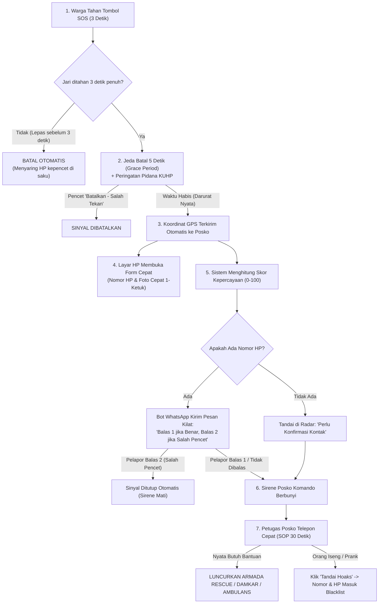

# Ringkasan Alur & Solusi: Anti-Spam, Hoaks, dan Validasi Tombol SOS
**Sistem:** SigapBumi  
**Kategori:** SOP & Alur Operasional Tanggap Darurat  
**Target Pembaca:** Tim Pengembang, Petugas Posko, dan Stakeholder  

---

## 1. Inti Masalah & Jawaban Singkat

> **Pertanyaan:**  
> *"Apakah pelapor wajib mengisi formulir nomor telepon, melampirkan foto, dan video sebelum tombol SOS dapat ditekan?"*  
>  
> **Jawaban:**  
> **TIDAK DIWAJIBKAN DI AWAL.**  
> Jika korban sedang hanyut banjir, terjebak kobaran api, atau tertimpa reruntuhan gempa, mereka **tidak memiliki waktu dan keleluasaan fisik untuk mengetik atau merekam video**. Mengharuskan pengisian form sebelum tombol aktif dapat mengorbankan nyawa korban sungguhan.  
>  
> **Solusinya:**  
> Terapkan **Alur 2 Tahap (*Progressive Disclosure*)** yang dipadukan dengan **Saringan Teknis Otomatis (Bot & Skor Kepercayaan)**.

---

## 2. Diagram Alur Tanggap Darurat (*Step-by-Step Flowchart*)

---

## 3. Rincian 3 Tahap Alur Operasional

### Tahap 1: Di Ponsel Pelapor (Detik 0 – Detik 5)
1. **Tahan 3 Detik (*Hold-to-Activate*):**
   * Warga harus menekan dan menahan tombol SOS selama 3 detik penuh.
   * Ada lingkaran animasi bertambah dan getaran ponsel (*haptic vibration*).
   * Jika jari lepas sebelum 3 detik, proses batal otomatis. *(Menghilangkan 90% insiden kepencet tidak sengaja).*
2. **Hitung Mundur 5 Detik (*Grace Period*):**
   * Layar menampilkan hitung mundur 5 detik dengan tombol mencolok: **"Batalkan (Saya Salah Tekan)"**.
   * Menampilkan peringatan tegas: *"Laporan darurat palsu dapat dilacak dan diancam pidana Pasal 220 KUHP."*
3. **Kirim Otomatis:**
   * Begitu detik ke-0 selesai, koordinat GPS dan jenis bantuan langsung terkirim ke posko.
4. **Form Pelengkap Ringkas:**
   * Layar HP tetap terbuka dan memberi kolom santai: *"Masukkan nomor HP Anda agar posko bisa memandu evakuasi"* dan tombol ambil foto cepat.

---

### Tahap 2: Di Sisi Sistem & Bot Otomatis (Detik 5 – Detik 30)
1. **Bot WhatsApp Kilat:**
   * Jika ada nomor HP, bot langsung mengirim pesan WhatsApp resmi dalam 2 detik:  
     > *"SigapBumi: Anda memicu SOS di [Lokasi]. Balas **1** jika BENAR butuh evakuasi, balas **2** jika SALAH PENCET."*  
   * **Efek:** Orang iseng biasanya langsung ciut dan menekan angka 2 (sinyal langsung batal).
2. **Perhitungan Skor Kepercayaan (0 – 100):**
   * **Skor Tinggi (Hijau):** GPS akurat (<30m) + Nomor HP terverifikasi + Ada laporan warga lain di radius 1 km.
   * **Skor Rendah (Kuning):** Hanya koordinat mentah tanpa nomor telepon atau terdeteksi memakai VPN/mock location.

---

### Tahap 3: Di Layar Operator Posko / Admin (Menit 1 – Menit 2)
1. **Radar Posko Real-time:**
   * Titik darurat muncul di peta admin dengan lencana status jelas (*Tervalidasi* vs *Perlu Konfirmasi*).
2. **SOP Telepon Cepat 30 Detik (*Two-Step Dispatch*):**
   * Posko tidak langsung menerjunkan armada pemadam/ambulans secara buta.
   * Petugas posko menekan tombol **"Telepon Pelapor"** di dashboard untuk berbicara selama 15–30 detik memastikan kondisi korban dan akses jalan.
3. **Penindakan Orang Iseng (Blacklist):**
   * Jika ternyata iseng/prank, petugas cukup klik tombol merah **"Tandai Hoaks / Prank"**.
   * Sirene posko seketika mati.
   * Nomor HP dan ID ponsel pelaku otomatis masuk **Daftar Hitam (*Blacklist*)**, sehingga perangkat tersebut tidak akan pernah bisa membunyikan sirene darurat lagi.

---

## 4. Matriks Perbedaan: Tombol SOS vs Form Lapor Biasa

| Aspek Penanganan | Tombol Darurat SOS (`SosFab.tsx`) | Form Laporan Warga Biasa (`/lapor`) |
| :--- | :--- | :--- |
| **Kondisi Pengguna** | Bahaya maut, genting, panik | Informasi kerusakan jalan, banjir surut, pasca-bencana |
| **Syarat Kirim** | **Cukup tahan 3 detik** (GPS otomatis) | **Wajib mengisi formulir** |
| **Nomor Telepon** | Opsional / Otomatis tersimpan | **Wajib diisi** |
| **Foto & Video** | Opsional (ambil kilat jika situasi aman) | **Wajib lampirkan minimal 1 foto bukti** |
| **Respon Posko** | Sirene berbunyi & panggilan telepon operator | Masuk antrean verifikasi laporan petugas |

---

## 5. Ringkasan Tindakan untuk Tim

1. **Jaga Kemudahan Korban:** Tombol SOS tetap mudah dan cepat diakses korban darurat.
2. **Pasang Hambatan Cerdas:** Terapkan *Hold 3 Detik* + *Grace Period 5 Detik* + *Peringatan Hukum*.
3. **Bantu Petugas dengan SOP:** Petugas posko wajib verifikasi telepon 30 detik sebelum armada meluncur.
4. **Berikan Sanksi Sistem:** Fitur tombol *"Tandai Hoaks"* untuk mematikan sirene dan mem-blacklist nomor pelaku.

